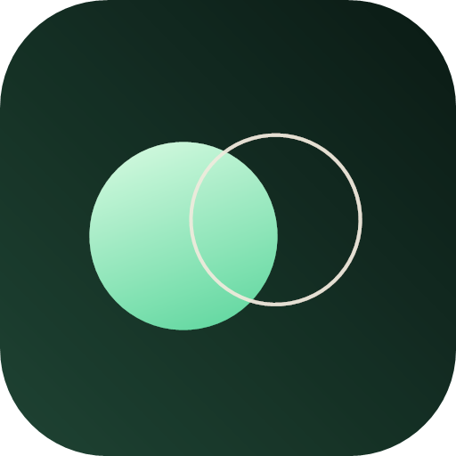

<p align="center">
  
</p>

<h1 align="center">QingYi 轻译</h1>

---

<p align="center"><strong>Turn text you can't read into text you can.</strong></p>

<p align="center">Text translation · Image crop · Camera OCR · A translation assistant you can ask</p>

<p align="center">
  
  
  
  
  
  
</p>

<p align="center"><a href="README.md">简体中文</a> ｜ <strong>English</strong></p>

---

## What is it

QingYi is a small Android app that does one thing: translation. No feed, no account, no ads — open it and translate.

The layout is inspired by Google Translate, with its own name, palette and icon. Translations run on **DeepSeek V4.1 Flash (`deepseek-flash`)**. Because the model understands images natively, there is no local OCR step: the picture goes straight to the model.

## Features

| Feature | Details |
| --- | --- |
| **Text** | Press “Translate” to send; 20 languages, paste, copy, swap |
| **Image** | Pick a photo, drag the crop box, translated text is overlaid in place |
| **Camera** | CameraX preview, shutter, then crop and translate |
| **Assistant** | Ask follow-ups about tone, context, alternatives, or why it was translated that way |
| **Visual context** | A cropped translation also sends the full frame as context; full-image translation sends one image |
| **Privacy** | The API key stays on the device; no account, analytics or backend |

## Install

Download `QingYi-release.apk` from [Releases](https://github.com/boluo140716/QingYi/releases/latest).

- Android 7.0 (API 24) and above
- About **1.8 MB**
- On first launch: avatar in the top-right → paste your DeepSeek API key

```bash
adb install -r QingYi-release.apk
```

Create a key at [platform.deepseek.com](https://platform.deepseek.com). Defaults: model `deepseek-flash`, base URL `https://api.deepseek.com/v1`.

## Usage

1. **Text** — type or paste, then tap “Translate”
2. **Image** — “图片” → pick → adjust the box → “翻译选中区域”
3. **Camera** — “相机” → aim → shutter → crop → translate
4. **Ask** — “解释 / 更口语”, or the chat icon, to keep asking

Crop handles: four corners resize, each edge moves independently, and only the centre moves the whole box. Haptic feedback on grab.

## Stack

| Layer | Choice |
| --- | --- |
| UI | Jetpack Compose + Material 3 |
| Architecture | Single Activity + `AppViewModel` (`mutableStateOf`) |
| Camera | CameraX 1.3.4 |
| Images | BitmapFactory + ExifInterface |
| Translate / vision | DeepSeek `deepseek-flash`, OpenAI-compatible Chat Completions |
| Network | `HttpURLConnection` (no OkHttp / Retrofit) |
| Settings | SharedPreferences (no DataStore / Room) |

Images are sent as base64 `data:` URLs inside `image_url` blocks with `detail=original`, capped at ~1024 tokens each.

## Build

JDK 17, Android SDK Platform 34, Build-Tools 34.

```bash
./gradlew :app:assembleRelease
# app/build/outputs/apk/release/app-release-unsigned.apk (~1.8 MB)
```

R8 and resource shrinking are enabled. Sign before installing:

```bash
apksigner sign --ks your.keystore --out QingYi-release.apk \
  app/build/outputs/apk/release/app-release-unsigned.apk
```

> On Windows, a project path containing `&` breaks `gradlew.bat` (`%~dp0` is unquoted). Move the project or use a junction:
>
> ```powershell
> cmd /c mklink /J C:\qy "D:\path\to\QingYi"
> cd C:\qy
> .\gradlew.bat :app:assembleDebug
> ```

## FAQ

**Why do I need my own API key?**
Translation and vision call DeepSeek directly — there is no relay server. The key stays on your device and you pay your own usage.

**How many images are sent?**
A crop smaller than the full frame sends two: the full frame for context and the crop to translate. A full-frame selection sends one. Each image costs at most ~1024 tokens.

**Where does my data go?**
Only to DeepSeek (`api.deepseek.com`): text, images and follow-up questions. No other backend, no analytics SDK.

**Why no iOS version?**
The app leans on CameraX, Android storage and Compose. iOS would need a separate implementation.

**Why is the release only 1.8 MB?**
Debug builds skip shrinking and pull in `material-icons-extended` (thousands of icons). Release uses R8 and resource shrinking, keeping only what is used.

## License

[MIT](LICENSE)
